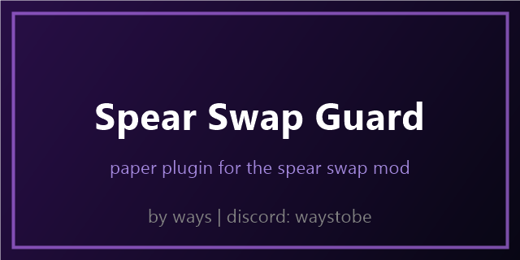

# spear swap guard

a small paper plugin for server owners. it decides who can use the spear swap mod on your server.

the mod asks the server when a player joins. this plugin answers on the channel `sprswp:hs`, and only if the player has the permission. if it does not answer, the mod stays off for that player.

## config

`allow-spear-swap` in config.yml is true by default. set it to false and spear swap is off for everybody.

the permission is `spearswapguard.allow` and everybody has it by default. take it away from a group with your permissions plugin if you do not want them to use it.

## install

drop the jar from the releases page into your plugins folder and restart. it is made for paper 1.20 and up.

## about the code

i do not have the original project anymore, so the code in `src` is decompiled from the jar. `res` has plugin.yml and config.yml.

all rights reserved, see LICENSE.
